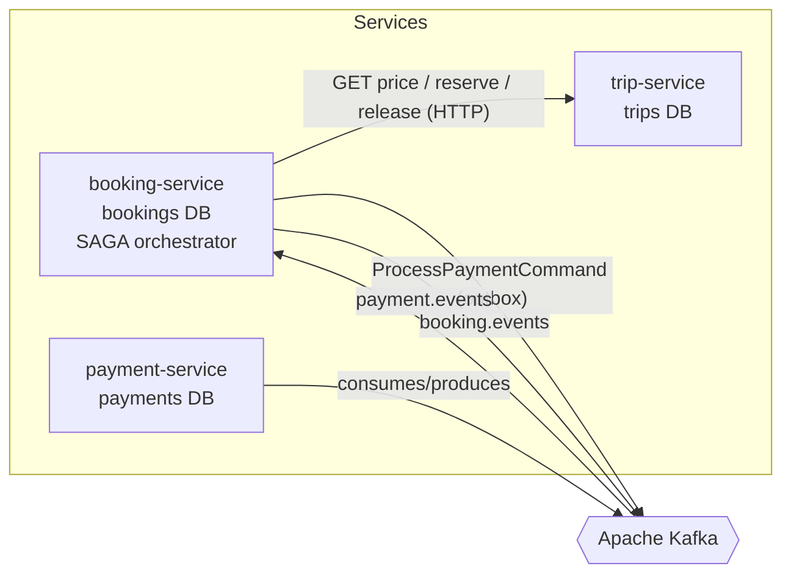
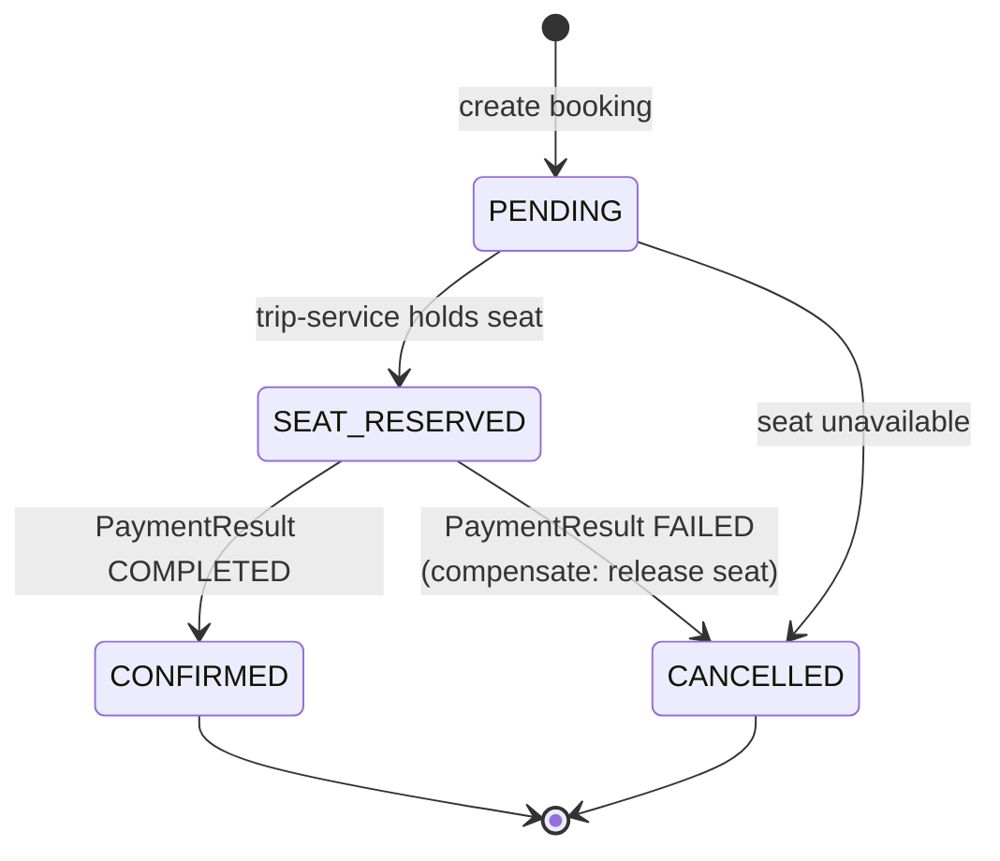
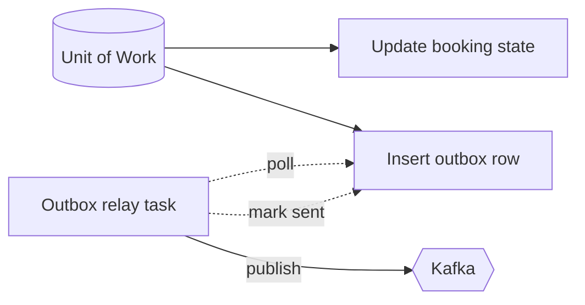
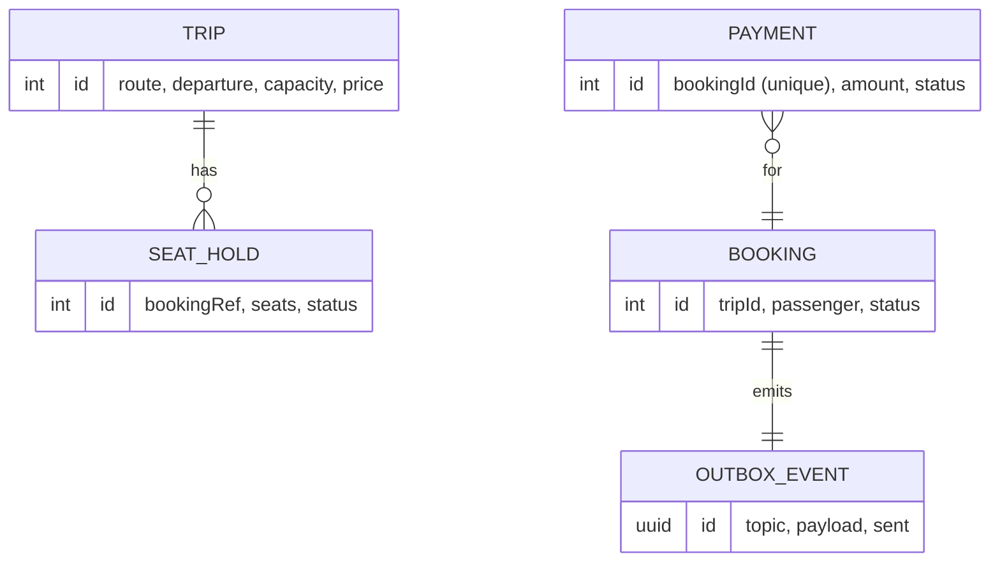

# TransitFlow (Python) — Architecture

This document explains **how** the Python edition of TransitFlow is built and, more
importantly, **why**. It mirrors the Java reference's design; the guiding
constraint is the one that defines distributed systems: each service owns its data,
and there is no shared database transaction spanning services. Every decision below
follows from that.

## 1. Context

TransitFlow lets passengers book seats on scheduled trips and pay for them. A single
booking touches three bounded contexts:

- **Trips** — what seats exist and whether they're available.
- **Bookings** — the passenger's intent and its lifecycle.
- **Payments** — money, which can succeed or fail.

These are separate services with separate PostgreSQL databases. The challenge is
making a booking *atomic from the passenger's point of view* while each service
commits only to its own database.

## 2. Communication styles — and when we use each

| Style | Used for | Why |
|-------|----------|-----|
| **Synchronous HTTP** | `booking → trip` seat reservation & price lookup | The booking cannot proceed without a confirmed seat hold. We need an immediate yes/no, and it is naturally request/response. |
| **Asynchronous events (Kafka)** | payment flow, terminal booking events | Payment is slow and can fail; the passenger shouldn't hold a connection open for it. Decoupling here buys resilience and independent scaling. |

> **Trade-off:** the synchronous seat reservation introduces temporal coupling
> between `booking` and `trip`. We accept it because a seat hold must be immediate
> and strongly consistent; we isolate the blast radius with a timeout and treat a
> reservation failure as a terminal booking failure (no SAGA needed).

## 3. The consistency problem and the SAGA solution

A booking that reserves a seat **and** charges a card spans two services' databases.
A distributed transaction (2PC) would couple their availability and doesn't scale.
Instead we use an **orchestrated SAGA**: a sequence of local transactions, each with
a **compensating action** that semantically undoes it.

`booking-service` is the orchestrator. It owns the state machine:

The orchestrator (`orchestrator.py`) performs the **remote** calls (HTTP to
trip-service) *outside* any database transaction, and delegates the atomic
state-change-plus-outbox writes to `store.py`. See
[ADR-0003](docs/adr/0003-saga-orchestration-over-choreography.md).

## 4. Reliable event publishing — the outbox pattern

The orchestrator must do two things when a booking changes: **persist the new
state** and **publish an event**. Doing them as two separate operations (commit to
Postgres, then produce to Kafka) is a dual-write — a crash in between loses the
event or publishes one for a change that rolled back.

The **transactional outbox** fixes this: the event is inserted into the
`outbox_events` table **in the same local transaction** as the state change. In
Python this is a single async SQLAlchemy **Unit of Work** that exposes both the
`bookings` and `outbox` repositories; committing the UoW commits both or neither.

A separate asyncio **relay** (`outbox_relay.py`) polls unsent rows, publishes them
to Kafka, and marks them sent. The DB transaction is the single source of truth;
Kafka eventually catches up, at-least-once.

See [ADR-0004](docs/adr/0004-transactional-outbox.md).

## 5. Idempotent consumers

Kafka guarantees **at-least-once** delivery: a consumer can see the same message
twice (a rebalance before the offset commits, or the relay re-publishing a row).
Charging a card twice is unacceptable. `payment-service` keys idempotency on the
`bookingId` with a **unique constraint** on `payments.booking_id`: a redelivered
`ProcessPaymentCommand` finds the existing row and returns the original result
instead of charging again. `booking-service` ignores any payment result for a
booking already in a terminal state. See
[ADR-0005](docs/adr/0005-idempotent-consumers.md).

## 6. Testability by construction

The core logic of each service depends only on a **Unit of Work protocol**, not on
SQLAlchemy or Kafka directly. In production the UoW opens a session and transaction;
in tests an in-memory fake drops straight in. That is what lets the SAGA decisions,
seat-reservation idempotency, and payment rules be unit-tested with no database and
no broker (`tests/`, 17 tests). The pure-domain methods live on the aggregates
(`Trip.reserve/release`, `Booking` state transitions).

## 7. Data ownership

No service reads another's tables. `trip-service` never sees a `payment` row; it
only knows a seat was reserved against a booking reference. This is what lets each
service evolve, deploy, and scale independently.

## 8. Correlation IDs

A correlation id is generated at `booking-service` when a booking is created (or
taken from an inbound `X-Correlation-Id` header), propagated to trip-service on
every HTTP call, and carried inside every Kafka event. A `contextvars`-based log
filter stamps it on every log line, so one booking is traceable across all services.

## 9. Deliberate non-goals

To keep the codebase readable, the following are **documented but not implemented**:

- **Dead-letter queues / bounded retry** — a poison message is logged and skipped;
  a production system would route it to `<topic>.DLT` with a replay tool.
- **Schema registry / Avro** — events are JSON; a real platform would enforce
  contracts with a registry.
- **Exactly-once Kafka semantics** — we rely on idempotent consumers instead, which
  is the pragmatic industry default.

Naming these trade-offs is itself the point: a staff-level system is defined as much
by the trade-offs it *names* as by the code it ships.
