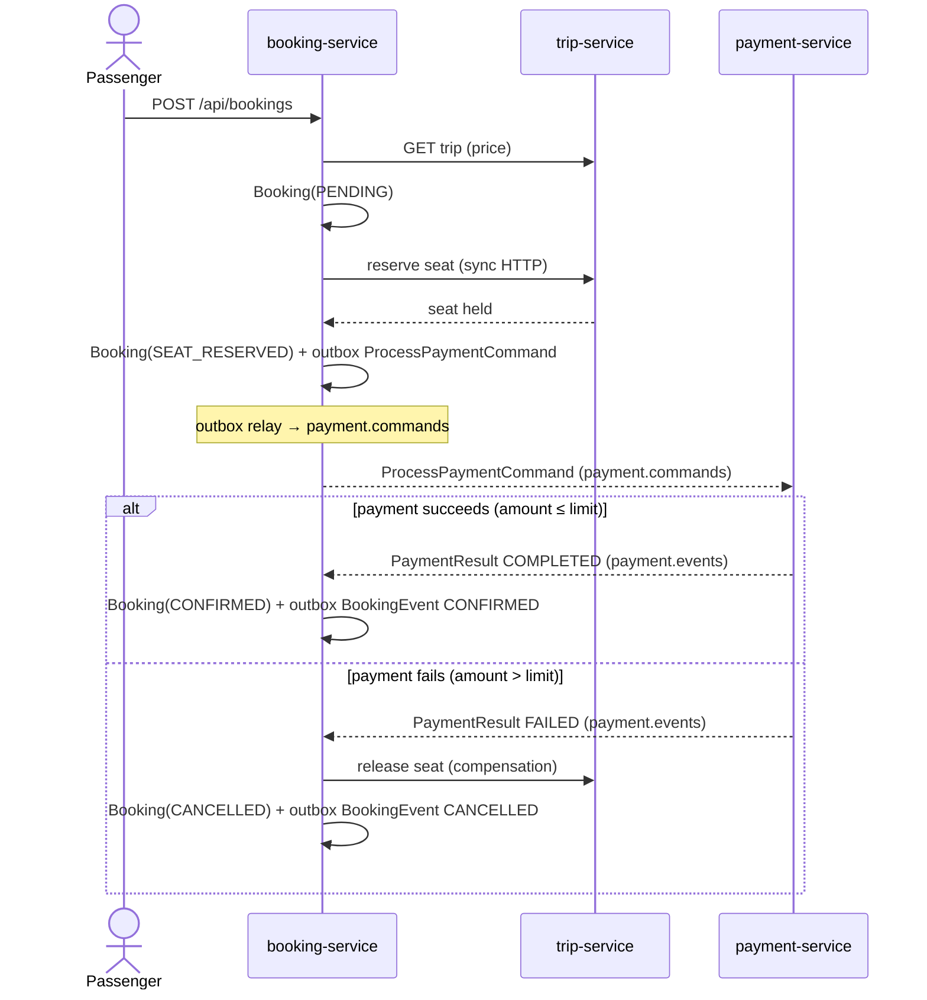

<div align="center">

# 🚍 TransitFlow (Python)

**An event-driven transit ticketing platform — microservices, Kafka, and the SAGA pattern, built to production-grade standards.**

Buy tickets, reserve seats, and process payments across a choreography of independent services that stay consistent **without distributed transactions** — using an orchestrated SAGA with compensation, the transactional outbox pattern, and idempotent consumers.


</div>

---

## Why this project exists

Most "microservices demo" repos are a REST monolith split into folders. This one
models the hard part of distributed systems: **keeping data consistent across
services that each own their own database, when there is no shared transaction**.

The booking flow spans three services and a payment that can fail. TransitFlow
solves it the way real platforms do — with an **orchestrated SAGA** and
**compensating actions**, reliable event publishing via the **outbox pattern**,
and **idempotent consumers** so that a redelivered Kafka message never
double-charges a passenger.

> 📐 Read **[ARCHITECTURE.md](ARCHITECTURE.md)** for the full design and trade-offs,
> and **[docs/adr/](docs/adr/)** for the architecture decision records.

## The booking SAGA, in one picture



## Services

| Service | Port | Owns | Responsibility |
|---------|------|------|----------------|
| `trip-service` | 8081 | `trips` DB | Routes, schedules, seat inventory; reserve/release seats (idempotent on `bookingRef`) |
| `booking-service` | 8082 | `bookings` DB | **SAGA orchestrator**; owns the booking lifecycle + transactional outbox |
| `payment-service` | 8083 | `payments` DB | Idempotent payment processing (unique on `bookingId`); emits payment events |

Each service is a FastAPI/uvicorn process; `payment-service` is a Kafka worker with
a small health endpoint. Background work (the outbox relay and the Kafka consumers)
runs as asyncio tasks started on the app lifespan.

## Run it

Everything — services, Kafka (KRaft, single broker), and one PostgreSQL per
service — comes up with a single command. No local Python needed (services build
inside the Docker image).

```bash
docker compose up --build
```

> **Note (corporate networks / TLS inspection):** the image installs Python
> dependencies with `pip` *inside* the container. If your network inspects TLS, the
> in-container install can fail to validate PyPI's certificate (`SSLError /
> CERTIFICATE_VERIFY_FAILED`). The secure fix is to trust your corporate root CA
> inside the build — mount it and point pip at it, e.g. add to the Dockerfile
> `ENV PIP_CERT=/certs/corp-root.pem` with the CA bind-mounted at build time, or
> run on an unrestricted network / CI where `docker compose up --build` works
> as-is. **Do not** disable certificate verification (`--trusted-host`) to get
> around it. For a local (non-Docker) install, pip ≥ 23.2's
> `--use-feature=truststore` uses the OS trust store, which already has the CA:
>
> ```bash
> python -m venv .venv
> .venv/Scripts/python -m pip install --use-feature=truststore -r requirements.txt   # Windows
> pytest
> ```

Then exercise the flow:

```bash
# 1. List available trips
curl http://localhost:8081/api/trips

# 2. Book a seat (triggers the SAGA) — trip 1 is 120.00, well under the limit
curl -X POST http://localhost:8082/api/bookings \
  -H 'Content-Type: application/json' \
  -d '{"tripId": 1, "passengerName": "Ada Lovelace", "seatCount": 1}'

# 3. Poll the booking until it reaches CONFIRMED (or CANCELLED)
curl http://localhost:8082/api/bookings/1
```

> 💡 The payment service **deterministically fails** payments above
> `TRANSITFLOW_PAYMENT_DECLINE_ABOVE` (default `500.00`). Book trip **3**
> ("Andes Premium", 600.00/seat) to watch the **compensation path** — seat release
> + booking cancellation — end to end:
>
> ```bash
> curl -X POST http://localhost:8082/api/bookings \
>   -H 'Content-Type: application/json' \
>   -d '{"tripId": 3, "passengerName": "Alan Turing", "seatCount": 1}'
> # → ends CANCELLED, and trip 3's seats_available returns to 20
> ```

## Observability

Every service exposes Prometheus metrics at `GET /metrics`, scraped by a bundled
**Prometheus** and visualised in a pre-provisioned **Grafana** dashboard — all
started by the same `docker compose up`.

| Tool | URL | Notes |
|------|-----|-------|
| Prometheus | http://localhost:9090 | Scrapes `trip-service:8081`, `booking-service:8082`, `payment-service:8083` at `/metrics` every 5s |
| Grafana | http://localhost:3000 | Anonymous access as **Admin** (no login); dashboard **"TransitFlow — SAGA & Payments"** is pre-loaded |

**Business metrics** (identical names across the Java/Go/Python ports, so one
dashboard works for all three):

| Metric | Type | Labels | Meaning |
|--------|------|--------|---------|
| `transitflow_bookings_created_total` | Counter | — | Bookings created (SAGA started) |
| `transitflow_bookings_total` | Counter | `status` (`CONFIRMED`/`CANCELLED`) | Bookings reaching a terminal state |
| `transitflow_payments_total` | Counter | `result` (`COMPLETED`/`FAILED`) | Payments processed |
| `transitflow_outbox_pending` | Gauge | — | Unsent transactional-outbox rows (updated each relay poll) |
| `transitflow_saga_duration_seconds` | Histogram | — | Seconds from booking creation to terminal state |
| `transitflow_http_request_duration_seconds` | Histogram | `method`, `handler`, `status` | HTTP request latency (custom middleware) |

> The HTTP latency metric is emitted by a small middleware in
> [`transitflow/metrics.py`](transitflow/metrics.py) — its exact name is
> **`transitflow_http_request_duration_seconds`** (use
> `transitflow_http_request_duration_seconds_bucket` with `histogram_quantile`).
>
> **Single worker required:** prometheus-client's default registry is
> in-process, so each service must run with **one** uvicorn worker (the default
> here). With multiple workers you'd need prometheus-client multiprocess mode.

## What this demonstrates

- **Database-per-service** with no shared schema — services integrate only through
  events and well-defined APIs.
- **Orchestrated SAGA** with explicit compensation, instead of a two-phase commit
  that doesn't scale.
- **Transactional outbox** — business state and the "event to publish" commit in the
  *same* local transaction (one async SQLAlchemy Unit of Work), so an event is never
  lost or published for a rolled-back change.
- **Idempotent consumers** keyed on a natural business id (unique `bookingId`) —
  safe under Kafka's at-least-once delivery; a redelivered command never charges twice.
- **Correlation IDs** propagated across services via the `X-Correlation-Id` header
  and carried in every event, for traceable flows.
- **Testable core** — the SAGA decisions, reservation logic, and payment rules are
  unit-tested against in-memory fakes (no DB, no Kafka). `pytest` → **17 passing**.

## Tech

**Language:** Python 3.12 · **Web:** FastAPI + uvicorn · **Data:** SQLAlchemy 2.0
(async) + asyncpg · **Messaging:** aiokafka · **Schemas/Config:** pydantic v2 +
pydantic-settings · **Infra:** Apache Kafka (KRaft) · PostgreSQL · Docker Compose.

## Polyglot trilogy

TransitFlow is implemented three times, idiomatically, in three stacks — same
domain, same event field names, same SAGA flow — as a study in how the *patterns*
survive a change of language:

- ☕ **[`transitflow`](../transitflow)** — Java 21 / Spring Boot (the reference)
- 🐍 **`transitflow-py`** — Python 3.12 / FastAPI (this repo)
- 🐹 **`transitflow-go`** — Go (sibling)

## License

MIT — see [LICENSE](LICENSE). Copyright (c) 2026 Felipe Feres.
